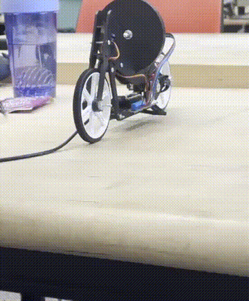

# arduino self-balancing bike

a reaction-wheel motorcycle prototype built for mechanical and robotics engineering coursework at northern arizona university. an arduino reads the bike's roll angle and flywheel encoder, then adjusts motor duty to counter a lean. the project connects mechanical assembly, embedded c++, sensor integration, feedback control, and experimental tuning.



[watch the cropped, silent balance demo](media/balance-demo.mp4) · [watch the sensor demonstration](media/sensor-demo.mp4) · [read the controller report](MA6/MA6-report.pdf) · [open the main sketch](MA6/MA6_4/MA6_4.ino)

## project highlights

- assembled a motorcycle with a motor-driven reaction wheel and integrated an imu, encoder, and motor carrier.
- implemented a 100 hz sensing and control loop with a separate 10 hz serial interface.
- added adjustable setpoint and gains, signed motor commands, duty limiting, debug telemetry, and tip detection with active flywheel braking.
- compared proportional, derivative, and flywheel-speed damping gains through repeated physical trials.
- developed separate communication-fault handling and bluetooth low energy variants for further testing.

## hardware and control

the main controller uses an arduino nano 33 iot, arduino nano motor carrier, bno055 imu, flywheel motor, and quadrature encoder. the recorded wiring uses motor channel `M3` and `encoder1`. the earlier serial, timing, and pwm exercises target an arduino uno.

at each 100 hz update, the controller reads roll and flywheel speed, calculates the error, combines the control terms, and limits the command to a duty between -100 and 100. the source uses:

```text
error = setpoint - roll
p effort = -kp * error
d effort = kd * (previous error - error)
flywheel damping = -kf * flywheel speed
requested effort = p effort + d effort + flywheel damping
```

the derivative term is a sample-to-sample error difference at the fixed update rate. it is not divided by the sample period. `kf` provides flywheel-speed damping; the main controller does not implement an integral term. gains and signs depend on this bike's sensor orientation, wiring, and 100 hz update rate.

when the absolute error exceeds 15 degrees, the controller switches from balance effort to active braking. it re-arms below 5 degrees. the software starts with balance disabled and all gains at zero. the main sketch and the experimental variants have different braking and fault-handling details; review the selected sketch before running hardware.

## results and current limits

the best recorded physical run lasted approximately 8 seconds, supported by both the [demo gif](media/balance-demo.gif) and the [telemetry capture](media/balance-telemetry.png). at the selected gains (`kp ≈ 50`, `kd ≈ 5`, `kf ≈ 1`), the three trials lasted 2.32, 2.90, and 2.27 seconds, averaging about 2.50 seconds, the repeatability figure for that setting; these are prototype measurements, not a guarantee of sustained balance.

the telemetry capture records software events from balance-on to tip-detected approximately 8 seconds apart and corroborates the gif.

all 11 completed sketch folders were compiled for their target boards during preparation of this public snapshot, and each `.ino` has a byte-identical `.txt` copy; the ble and communication-fault variants remain experimental, since compilation does not verify phone connectivity, fault recovery, or physical balance performance.

## repository guide

| location | contents |
| --- | --- |
| `MA1/` | data types, serial output, signal plotting, simulated sensor conversion |
| `MA2/` | conditionals, scheduled execution, and helper functions |
| `MA3/` | serial menu and pwm control |
| `MA4/` | mechanical build photos and team project plan |
| `MA5/` | motor commands, imu readings, encoder feedback, and sensor direction notes |
| `MA6/MA6_4/` | main balance controller and an earlier source backup |
| `MA6/big_fix/` | experimental communication-fault checks and bounded serial parsing |
| `MA6/MA6_4_kf_wireless/` | experimental ble uart input and mirrored telemetry |
| `media/` | balance and sensor demonstrations, plus balance telemetry |

each assignment folder includes its project report as a pdf. the reports retain the original technical observations; they document the project's development rather than serve as general hardware specifications. source changes and later variants may differ from earlier report descriptions.

## build and run

install the arduino ide or arduino cli and the appropriate board package. the public snapshot was compiled with these installed versions:

| dependency | version |
| --- | --- |
| arduino avr boards | 1.8.8 |
| arduino samd boards | 1.8.14 |
| `ArduinoMotorCarrier` | 2.0.3 |
| `BNO055` | 1.2.1 |
| `ArduinoBLE` | 2.1.0 |
| `Arduino_SpiNINA` | 0.0.2 |

the bno055 dependency must provide `BNO055_support.h` and the `bno055_*` api used in the source. it is not interchangeable with an arbitrary bno055 driver. the ble libraries are needed for the wireless variant.

the driver is the [arduino bno055 library](https://github.com/arduino-libraries/BNO055). with arduino cli installed, set up the dependencies using:

```sh
arduino-cli core update-index
arduino-cli core install arduino:avr@1.8.8 arduino:samd@1.8.14
arduino-cli lib update-index
arduino-cli lib install "ArduinoMotorCarrier@2.0.3" "BNO055@1.2.1"
arduino-cli lib install "ArduinoBLE@2.1.0" "Arduino_SpiNINA@0.0.2"
```

from the repository root, compile a single sketch folder:

```sh
arduino-cli compile --fqbn arduino:samd:nano_33_iot MA6/MA6_4
arduino-cli compile --fqbn arduino:samd:nano_33_iot MA6/big_fix
arduino-cli compile --fqbn arduino:samd:nano_33_iot MA6/MA6_4_kf_wireless
arduino-cli compile --fqbn arduino:avr:uno MA3/MA3_1
```

upload the selected sketch through the arduino ide after confirming the board, port, and wiring. the main sketch waits for a usb serial connection during startup. open the serial monitor at 9600 baud, keep the bike supported, and verify sensor and motor directions before enabling balance.

| main controller command | action |
| --- | --- |
| `0` / `1` | disable / enable balance |
| `2` | enter the roll setpoint in degrees |
| `3` / `4` / `5` | enter `kp` / `kd` / `kf` |
| `p` | stream basic telemetry |
| `e`, then `v` | show debug options, then stream detailed telemetry |
| `m` | return to the menu |

for numeric entry, send the menu command first, then the value. a newline or a 150 ms input pause completes entry. keep hands clear of the rotating flywheel and retain a way to disconnect motor power during trials.

## public snapshot

this portfolio edition includes completed code, project reports, and selected demonstration media. personal names were removed from filenames and written reports, with the original university and college branding preserved. private document metadata, local paths in documents, and identifying report details were removed. reports were rebuilt from sanitized pages. the balance demonstration was cropped to exclude background faces, and one report photograph containing background faces was omitted. the sensor demonstration preserves the bike footage and plot, with desktop titles and console paths cropped out. retained image and video content is not covered by masks. videos were exported without audio or original recording metadata.

course handouts, instructor answer keys, skeleton-only files, editable office originals, duplicate submission copies, and private planning notes are excluded. this repository starts with fresh history and neutral commit attribution so private coursework history is not published.
